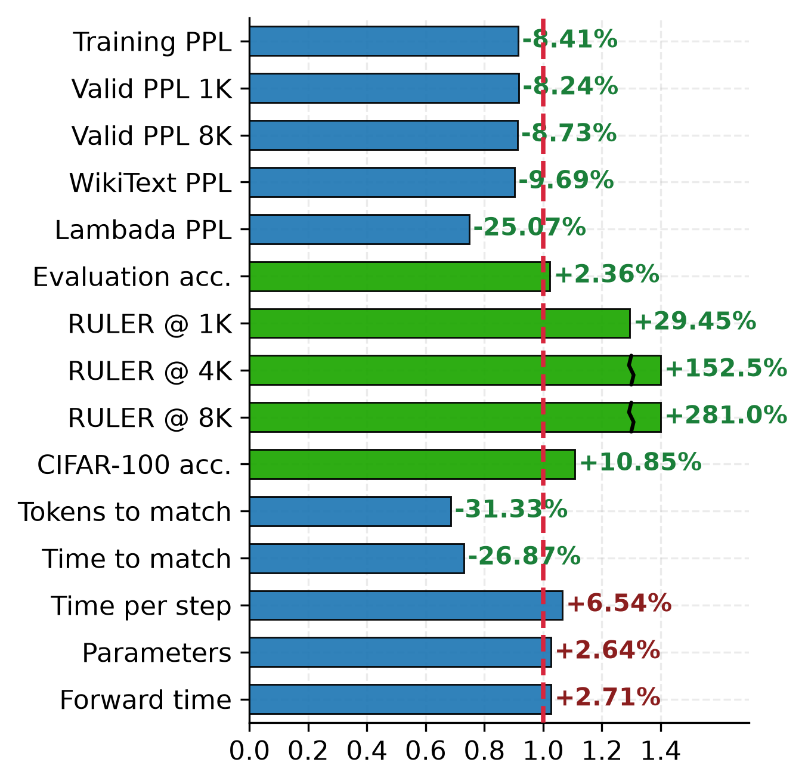
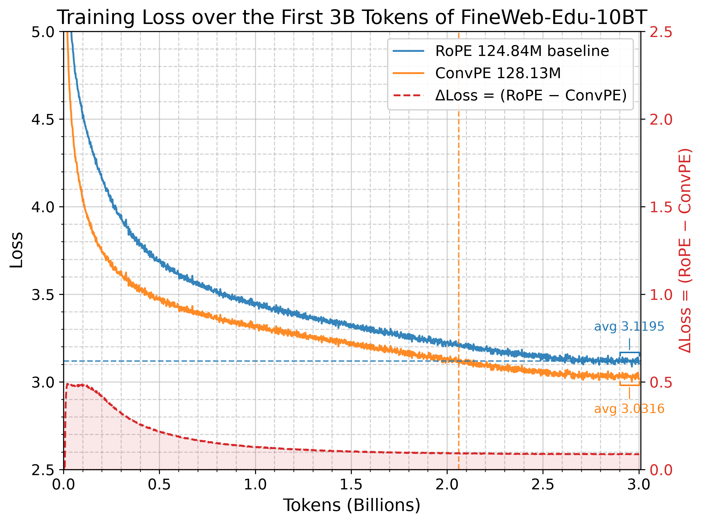

# ConvPE

**中文摘要**  
ConvPE（卷积位置编码）提升了 Transformer 模型在语言建模、长上下文扩展和视觉任务中的性能与效率。它通过对隐藏状态的低维投影进行轻量级因果卷积，将窗口化、内容依赖的偏置注入注意力分数。ConvPE 兼容 RoPE、任意注意力掩码和 KV 拼接。它还通过高维卷积支持高维位置嵌入。在复现中，ConvPE 优于五个一维基线和八个二维基线。

**English Abstract**  
ConvPE (Convolutional Position Embedding) improves both the performance and efficiency of Transformer models in language modeling, long-context extension, and vision. It injects a windowed, content-dependent bias into attention scores through a lightweight causal convolution over a low-dimensional projection of the hidden states. ConvPE is compatible with RoPE, arbitrary attention masks, and KV concatenation. It also supports high-dimensional positional embeddings via high-dimensional convolutions. In a reproduction, ConvPE outperforms five 1D baselines and eight 2D baselines.

## Pretraining Evaluations

| Dataset | Metric | RoPE | ConvPE | Random |
|:---:|:---:|:---:|:---:|:---:|
| WikiText-2 | word PPL ↓ | 46.56 | **42.05** | -- |
| LAMBADA | PPL ↓ | 118.10 | **88.49** | -- |
| LAMBADA | acc ↑ | 0.2507 | **0.2604** | -- |
| HellaSwag | acc | 0.2894 | **0.2949** | 0.25 |
| HellaSwag | acc norm | 0.3148 | **0.3272** | 0.25 |
| XStoryCloze | acc | 0.5460 | **0.5526** | 0.5 |
| PIQA | acc | 0.6251 | **0.6338** | 0.5 |
| PIQA | acc norm | 0.6208 | **0.6235** | 0.5 |
| ARC-Easy | acc | 0.5114 | **0.5421** | 0.25 |
| ARC-Easy | acc norm | 0.4487 | **0.4701** | 0.25 |
| WinoGrande | acc | 0.5091 | **0.5193** | 0.5 |
| BoolQ | acc | 0.5676 | **0.5893** | 0.5 |
| TruthfulQA-MC1 | acc | **0.2399** | 0.2375 | 0.25 |
| Average† | acc | 0.4372 | **0.4475** | -- |

† Mean of one accuracy per task (acc-norm for HellaSwag, PIQA, and ARC-Easy; acc otherwise), excluding the two perplexities.

## Context Extension

FineWeb-Edu-10BT validation language-modeling perplexity:

| Context | RoPE | ConvPE | RoPE 8K | ConvPE 8K |
|:---:|:---:|:---:|:---:|:---:|
| 1K | 22.5272 | **20.672 (-8.2%)** | -- | -- |
| 2K | 23.4439 | **20.1441 (-14.1%)** | -- | -- |
| 4K | 67.8413 | **20.6415 (-69.6%)** | -- | -- |
| 8K | 260.4544 | **27.8015 (-89.3%)** | 23.0702 | **19.7405 (-14.4%)** |

The 8K suffix denotes models continually trained with a context length of 8192.

RULER accuracy on twelve tasks:

| Task | RoPE 1K | ConvPE 1K | RoPE 2K | ConvPE 2K | RoPE 4K | ConvPE 4K | RoPE 8K @ 4K | ConvPE 8K @ 4K |
|:---|:---:|:---:|:---:|:---:|:---:|:---:|:---:|:---:|
| niah_single_1 | 0.614 | **0.890** | 0.004 | **0.722** | 0.000 | **0.314** | 0.030 | **0.688** |
| niah_single_2 | 0.612 | **0.664** | 0.000 | **0.038** | 0.000 | 0.000 | 0.010 | **0.022** |
| niah_single_3 | 0.090 | **0.180** | 0.000 | **0.014** | 0.000 | 0.000 | 0.002 | **0.010** |
| niah_multikey_1 | 0.198 | **0.200** | 0.118 | **0.194** | 0.000 | **0.002** | 0.036 | **0.186** |
| niah_multikey_2 | **0.002** | 0.000 | 0.000 | 0.000 | -- | -- | -- | -- |
| niah_multikey_3 | 0.000 | **0.008** | 0.000 | 0.000 | -- | -- | -- | -- |
| niah_multiquery | 0.104 | **0.186** | 0.029 | **0.179** | 0.000 | 0.000 | 0.016 | **0.089** |
| niah_multivalue | 0.149 | **0.187** | 0.127 | **0.186** | 0.000 | 0.000 | 0.025 | **0.128** |
| ruler_vt | **0.032** | 0.008 | 0.000 | **0.052** | 0.000 | **0.107** | 0.000 | **0.015** |
| ruler_cwe | 0.002 | 0.002 | 0.000 | **0.002** | -- | -- | -- | -- |
| ruler_fwe | 0.001 | **0.012** | 0.000 | **0.001** | -- | -- | -- | -- |
| ruler_qa_squad | 0.148 | **0.191** | 0.078 | **0.091** | 0.017 | **0.052** | 0.064 | **0.075** |
| Average† | 0.163 | **0.211** | 0.030 | **0.123** | 0.001 | **0.040** | 0.015 | **0.101** |

The last two columns report the context-extension models (8K suffix) evaluated at a 4K context length. Cells marked -- were not evaluated because both models were near zero on these tasks at the shorter lengths.  
† Average over all twelve tasks, with cells marked -- counted as zero.

## Peer Comparison

Independent reproduction. PPL is measured on the first 1M pretraining tokens; Eval Acc is the mean of eight accuracy metrics; RULER Acc is the mean over twelve RULER tasks.

| Method | Params (M) | ms/step | Mem (GiB) | PPL 1K | PPL 2K | PPL 4K | PPL 8K | Eval Acc (%) | RULER 1K | RULER 2K | RULER 4K |
|---|---:|---:|---:|---:|---:|---:|---:|---:|---:|---:|---:|
| NoPE | 163.470 | **141.30** | 10.77 | 24.34 | 173.71 | 1389.25 | 3618.99 | 42.78 | 19.31 | 0.15 | 0.00 |
| Composite | 163.498 | 180.02 | 11.01 | 21.34 | 38.15 | 246.16 | 984.34 | 44.37 | 25.97 | 0.88 | 0.09 |
| RoPE | 163.470 | 149.03 | 10.77 | 22.89 | 24.19 | 55.01 | 207.58 | 43.86 | 11.96 | 2.63 | 0.26 |
| ALiBi | 163.470 | 145.67 | 10.77 | 21.37 | 20.77 | 20.60 | 20.52 | 43.90 | 14.37 | 3.80 | 1.61 |
| CABLE | 163.691 | 188.05 | 13.17 | 20.71 | 20.01 | 19.68 | 19.52 | 44.72 | 19.80 | 7.69 | 3.22 |
| DAPE V2 | 163.512 | 273.71 | 20.25 | **19.47** | **18.71** | **18.31** | **18.09** | **44.74** | 26.11 | **17.09** | **7.45** |
| ConvPE | 166.764 | 156.00 | 11.21 | 20.52 | 19.95 | 20.67 | 29.33 | 44.66 | **26.58** | 14.46 | 3.49 |

## CIFAR

ViT-Tiny, 100 epochs:

| Model | Params (M) | CIFAR-10 | CIFAR-100 |
|:---:|---:|---:|---:|
| RoPE baseline (1D) | 5.346 | 0.910 | 0.627 |
| ConvPE2D w3d4 | 5.359 | 0.931 | **0.695** |
| ConvPE2D w3d8 | 5.372 | **0.933** | 0.683 |
| ConvPE2D w5d4 | 5.386 | 0.929 | 0.682 |
| ConvNet (reference) | 4.336 | 0.945 | 0.737 |

CIFAR-100 peer comparison (ConvPE2D is w3d4):

| Method | Params (M) | ms/step | CIFAR-100 acc (%) |
|---|---:|---:|---:|
| NoPE | 5.363 | 66.45 | 56.03 |
| 2D ALiBi | 5.363 | 66.63 | 61.38 |
| Composite2D | 5.596 | 78.29 | 63.50 |
| 2D RoPE | 5.363 | 78.44 | 64.17 |
| Learnable 2D abs. PE | 5.376 | **63.50** | 64.36 |
| Fixed 2D sin-cos | 5.363 | 66.65 | 65.07 |
| CABLE2D | 5.377 | 98.90 | 65.25 |
| DAPE2D V2 | 5.374 | 92.74 | 66.01 |
| ConvPE2D | 5.377 | 82.03 | **67.98** |

## Requirements

### Tilelang kernels 
#### Make sure your torch cuda version and tilelang cuda version is the same with python venv cuda version or system cuda version
    apt install python3-dev
    pip install -r requirements.txt

### Pytorch Flex kernels (Alternative)
    apt install python3-dev
    pip install -r requirements_flex.txt

#### Edit transformer_convpe.py import

    from attn_flex import convpe_attention as attention

## Demo Training  

    python3 train_wikitext.py

#### Run train_wikitext_plot.ipynb to see results.

    python3 train_cifar.py

## Pretraining

### 1. Prepare Data

#### Download  Data
First Download fineweb-edu-10BT first 4 parquets into data/fineweb-edu-10BT
https://www.modelscope.cn/datasets/AI-ModelScope/fineweb-edu/tree/master/sample/10BT

    ls data/fineweb-edu-10BT/
    000_00000.parquet  001_00000.parquet  002_00000.parquet  003_00000.parquet

#### Build data bin

    python3 step1_prepare_parquet.py

### 2. Pre-training

#### Train full dataset (Optional)

    set step2_pretrain.py TrainingArguments max_steps=2000 to -1

#### Start training
##### Use attn_tilelang_pretrain.py kernel for higher throughput (Optional)
    python3 step2_pretrain.py

#### Run step2_plot.ipynb to see results.

### 3. Pre-training evaluation

    python3 step3_pretrain_eval.py

#### Run step3_plot.ipynb to see results.

### 4. Context Length Extension Zero-Shot Evaluations

#### Edit model max_seq_len in config.json to 8192

    python3 step4_len_ext_eval.py

#### Run step4_plot.ipynb to see results.

### 5. Context Extension Training

#### download 013_00000.parquet into data/fineweb-edu-10BT
#### Edit model max_seq_len in config.json to 8192
    python3 step5_prepare_len_ext_parquet.py
    python3 step6_len_ext_ppl_eval.py
    python3 step7_len_ext_train.py
    python3 step8_len_ext_ppl_eval.py
    python3 step9_len_ext_eval.py

