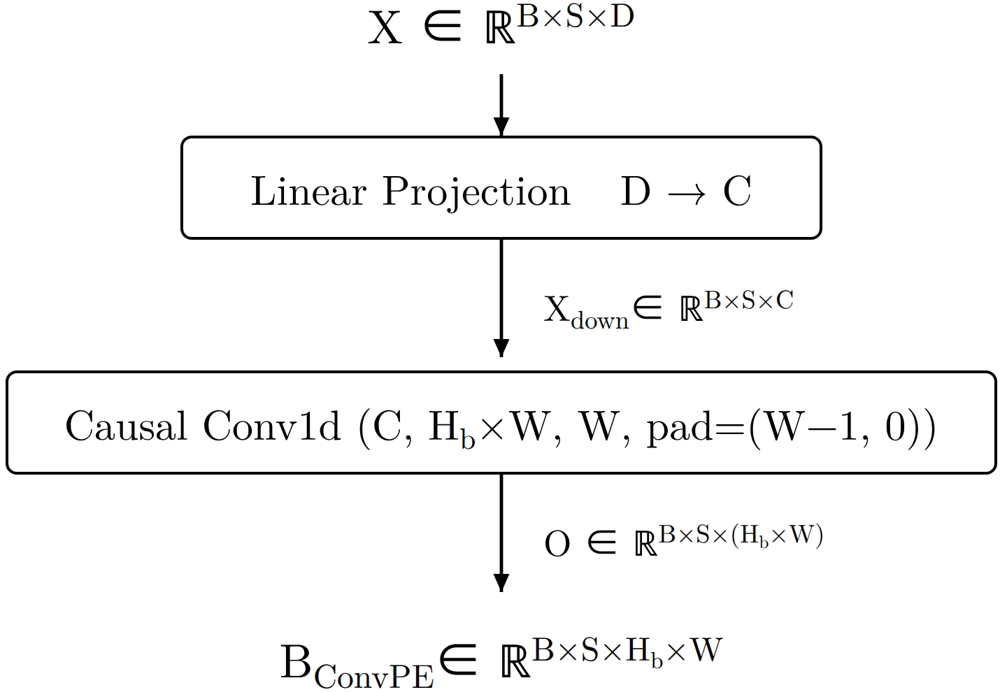
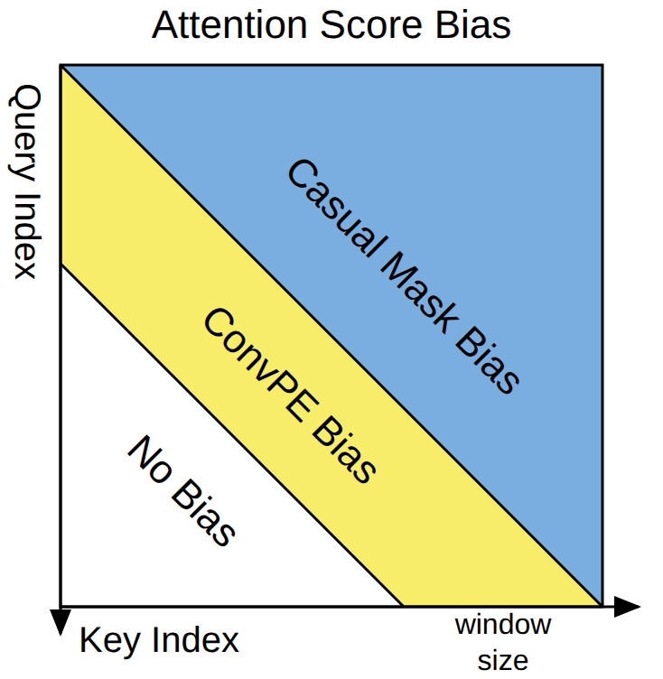
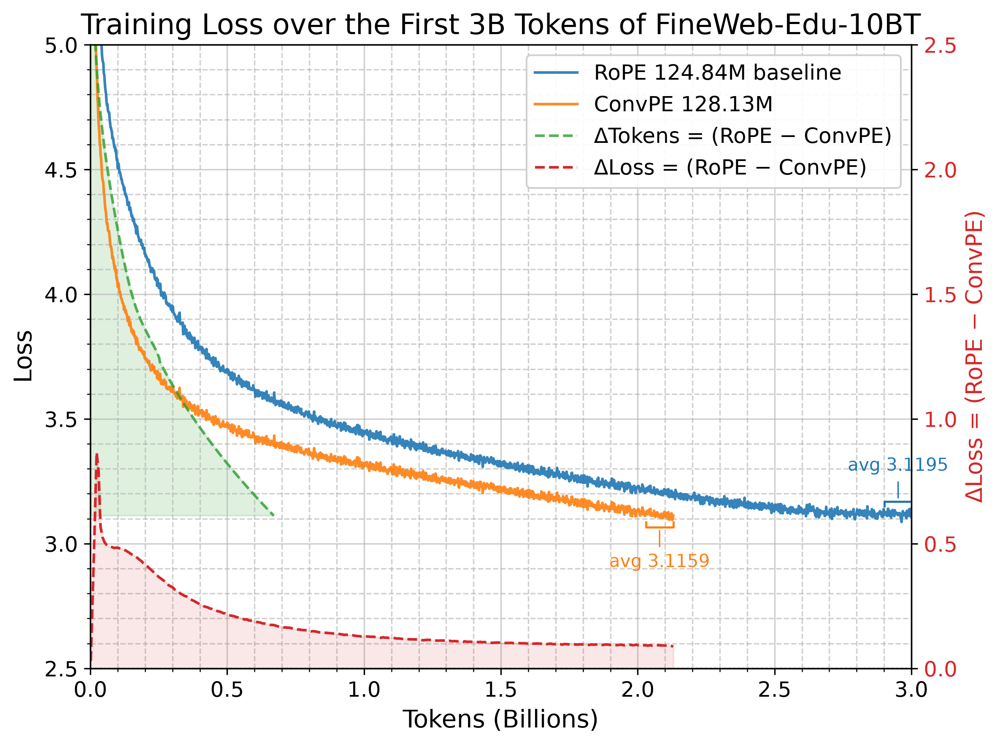

# ConvPE

ConvPE（卷积位置编码）在语言建模、长上下文外推和视觉任务中提升了Transformer的性能与效率。在FineWeb-Edu-10BT的30亿token上训练时，相较于RoPE基线，它将最终训练困惑度降低了8.41%，并将八项零样本准确率指标的均值相对提升了2.35%，而参数量仅增加2.64%，前向传播时间仅增加2.71%。它以少31.3%的训练token和约27%的更少实际训练时间达到了基线的最终损失。ConvPE的外推能力也更好：在100万训练token上，它将4K上下文处的困惑度降低了71.1%，8K上下文处降低了89.8%；在RULER基准上，它将1K处的平均准确率从16.3%提升至21.1%，2K处从3.0%提升至12.3%。在视觉任务中，ConvPE2D相较于RoPE将CIFAR-100准确率提升了10.9%。ConvPE通过一个轻量级因果卷积生成窗口化的、内容依赖的注意力分数偏置，并将其直接加到分数上，从而实现上述增益。由于该偏置的加入不改变查询或键，ConvPE可与RoPE、任意掩码、KV缓存及n维卷积组合使用，且窗口外的位置不受偏置影响。

ConvPE (Convolutional Position Embedding) improves Transformer performance and efficiency
across language modeling, long-context extrapolation, and vision. On 3B tokens of FineWeb-Edu-
10BT, it reduces final training perplexity by 8.41% and raises the mean of eight zero-shot accuracy
metrics by 2.35% relative to a RoPE baseline, while using only 2.64% more parameters and 2.71%
more forward-pass time. It matches the baseline’s final loss with 31.3% fewer training tokens and
about 27% less wall-clock training time. ConvPE also extrapolates better: on 1M training tokens it
reduces perplexity by 71.1% at 4K and 89.8% at 8K contexts, and on RULER it raises average accuracy
from 16.3% to 21.1% at 1K and from 3.0% to 12.3% at 2K. In vision, ConvPE2D improves CIFAR-
100 accuracy by 10.9% relative to RoPE. ConvPE realizes these gains with a windowed, content-
dependent attention-score bias generated by a lightweight causal convolution and added directly to
the scores. Because the bias is added without altering the queries or keys, ConvPE composes with
RoPE, arbitrary masks, KV caching, and n-dimensional convolutions, and leaves positions outside
the window unbiased.

|  |  |
|---|---|

## Pretrain curves on the first 3B tokens of FineWeb-Edu-10BT

## Pretraining Evaluations

| Dataset | Metric | RoPE baseline | ConvPE w128d16 | Random |
|:---:|:---:|:---:|:---:|:---:|
| wikitext | perplexity | 46.5636 | **42.0498** |-|
| lambada | perplexity | 118.1028 | **88.4866** |-|
| lambada | acc | 0.2507 | **0.2604** |0|
| hellaswag | acc | 0.2894 | **0.2949** |0.25|
| hellaswag | acc_norm | 0.3148 | **0.3272** |0.25|
| xstorycloze_en | acc | 0.5460 | **0.5526** |0.5|
| piqa | acc | 0.6251 | **0.6338** |0.5|
| piqa | acc_norm | 0.6208 | **0.6235**|0.5|
| arc_easy | acc | 0.5114 | **0.5421** |0.25|
| arc_easy | acc_norm | 0.4487 | **0.4701** |0.25|
| winogrande | acc | 0.5091 | **0.5193** |0.5|
| boolq | acc | 0.5676 | **0.5893** |0.5|
| truthfulqa_mc1 | acc | 0.2399 | 0.2375 |**0.25**|

## Context Extension Evaluations
#### FineWeb-Edu-10BT Validation Loss of 1M Tokens
|Context| RoPE baseline | ConvPE w128d16 |
|:---:|:---:|:---:|
|1K|3.1247|**3.0312**|
|2K|3.1684|**3.0021**|
|4K|4.2690|**3.0278**|
|8K|5.6443|**3.3575**|

#### RULER Tasks

| Task | RoPE @ 1K | ConvPE @ 1K | RoPE @ 2K | ConvPE @ 2K | RoPE @ 4K | ConvPE @ 4K |
|:---|:---:|:---:|:---:|:---:|:---:|:---:|
| niah_single_1   | 0.614 | **0.890** | 0.004 | **0.722** | 0.000 | **0.314** |
| niah_single_2   | 0.612 | **0.664** | 0.000 | **0.038** | 0.000 | 0.000 |
| niah_single_3   | 0.090 | **0.180** | 0.000 | **0.014** | 0.000 | 0.000 |
| niah_multikey_1 | 0.198 | **0.200** | 0.118 | **0.194** | 0.000 | 0.002 |
| niah_multikey_2 | 0.002 | 0.000 | 0.000 | 0.000 | - | - |
| niah_multikey_3 | 0.000 | 0.008 | 0.000 | 0.000 | - | - |
| niah_multiquery | 0.104 | **0.186** | 0.029 | **0.179** | 0.000 | 0.000 |
| niah_multivalue | 0.149 | **0.187** | 0.127 | **0.186** | 0.000 | 0.000 |
| ruler_vt        | **0.032** | 0.008 | 0.000 | **0.052** | 0.000 | **0.107** |
| ruler_cwe       | 0.002 | 0.002 | 0.002 | 0.002 | - | - |
| ruler_fwe       | 0.001 | **0.012** | 0.000 | 0.001 | - | - |
| ruler_qa_squad  | 0.148 | **0.191** | 0.078 | **0.091** | 0.017 | **0.052** |

## ConvPE2D validation accuracy on CIFAR-10, CIFAR-100.
|model|CIFAR-10 valid acc|CIFAR-100 valid acc|
|:-:|:-:|:-:|
|RoPE baseline 5.346M|0.910|0.627|
|ConvPE2D w3d4 5.359M|0.931|**0.695**|
|ConvPE2D w3d8 5.372M|**0.933**|0.683|
|ConvPE2D w5d4 5.402M|0.929|0.682|
|ConvNet 4.335M | 0.945 | 0.737 |
## Requirements

### Tilelang kernels 
#### Make sure your torch cuda version and tilelang cuda version is the same with python venv cuda version or system cuda version
    apt install python3-dev
    pip install -r requirements.txt

### Pytorch Flex kernels (Alternative)
    apt install python3-dev
    pip install -r requirements_flex.txt

#### Edit transformer_convpe.py import

    from attn_flex import convpe_attention as attention

## Demo Training  

    python3 train_wikitext.py

#### Run train_wikitext_plot.ipynb to see results.

    python3 train_cifar.py

## Pretraining

### 1. Prepare Data

#### Download  Data
First Download fineweb-edu-10BT first 4 parquets into data/fineweb-edu-10BT
https://www.modelscope.cn/datasets/AI-ModelScope/fineweb-edu/tree/master/sample/10BT

    ls data/fineweb-edu-10BT/
    000_00000.parquet  001_00000.parquet  002_00000.parquet  003_00000.parquet

#### Build data bin

    python3 step1_prepare_parquet.py

### 2. Pre-training

#### Train full dataset (Optional)

    set step2_pretrain.py TrainingArguments max_steps=2000 to -1

#### Start training
##### Use attn_tilelang_pretrain.py kernel for higher throughput (Optional)
    python3 step2_pretrain.py

#### Run step2_plot.ipynb to see results.

### 3. Pre-training evaluation

    python3 step3_pretrain_eval.py

#### Run step3_plot.ipynb to see results.

### 4. Context Length Extension

    python3 step4_len_ext_eval.py

#### Run step4_plot.ipynb to see results.

    python3 step5_len_ext_loss_eval.py

